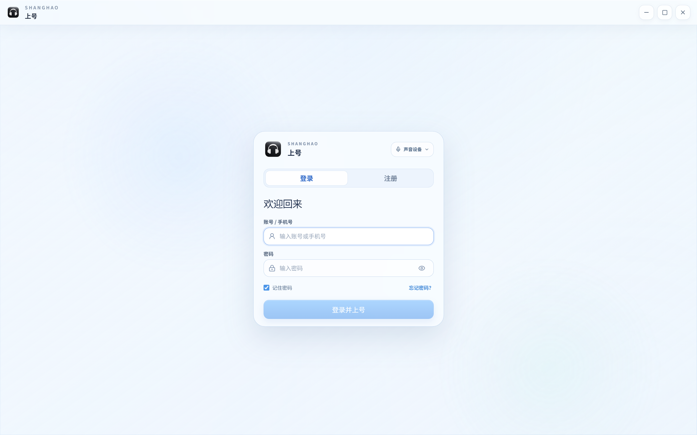
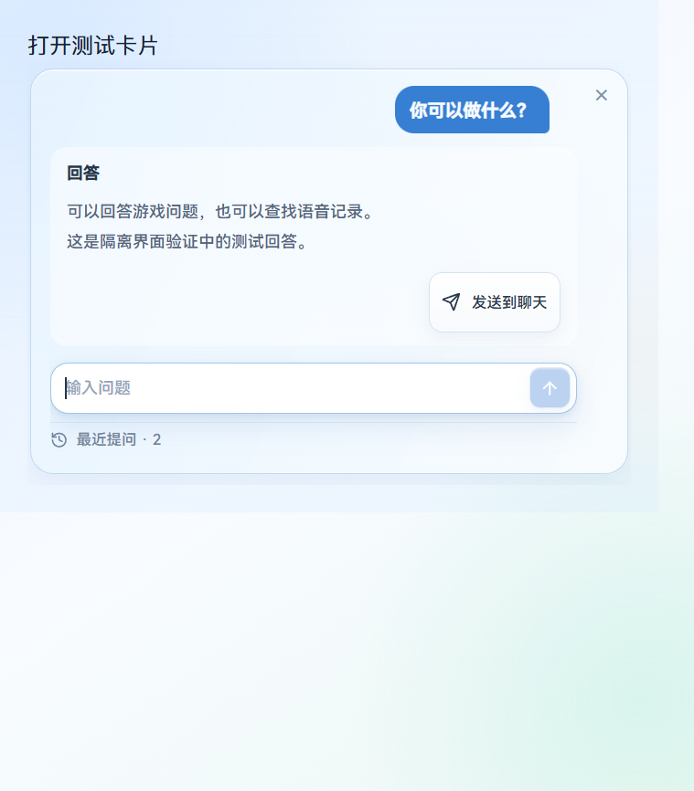
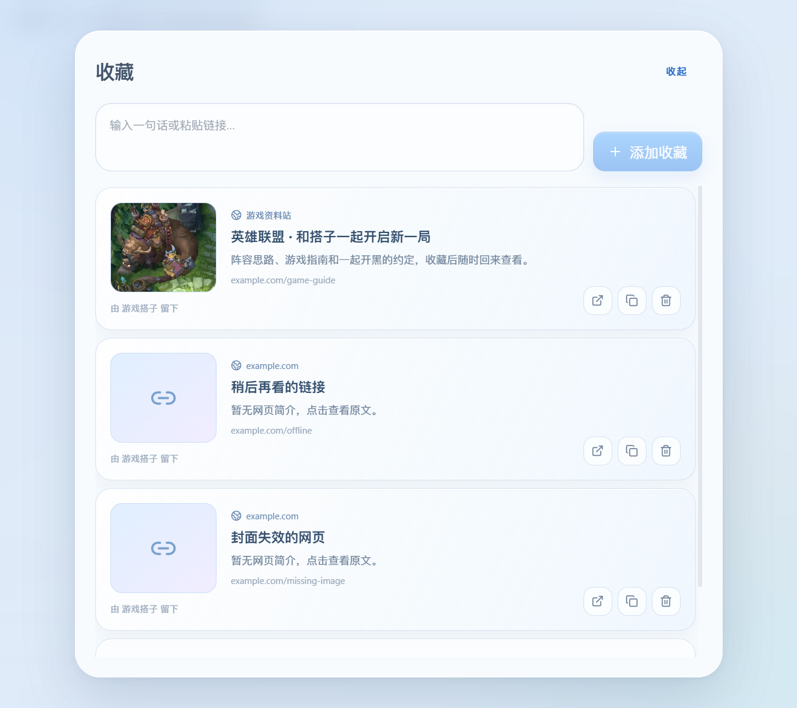
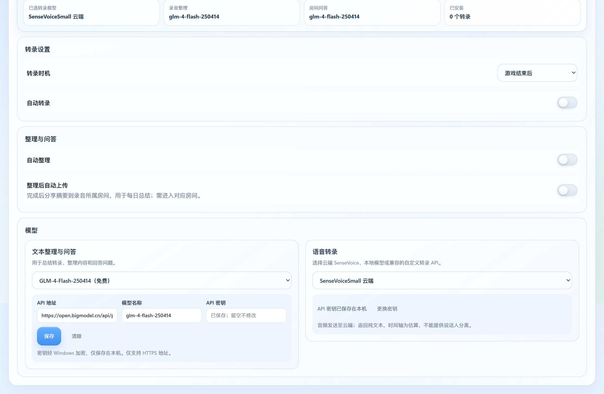

# 上号 v3.4.10（长录音转录与房间交互修复）

## 录音与模型

- 长录音自动分段。超过单次 1 小时或 50 MB 的录音，在本机转换为最多 15 分钟的片段后逐段转录，完成后合并；原始录音保留，取消时停止编码与请求并清理本次临时文件。云端返回纯文本，时间轴仍为估算，没有新增说话人分离能力。
- 录音标记显示“录音 1:01”和具体事件；“时钟 09点47分”明确表示当天时间。进度条临时提示约 2.5 秒后收起，完整事件保留在时间线。
- 文本与转录 API 表单统一，修复自定义选项跳回预设。新配置默认 GLM-4-Flash-250414 与 SenseVoiceSmall；已有选择保留，密钥仍需本机配置，未打入安装包。服务额度、余额和网络限制仍由提供商决定。

## 房间与助手

- 收藏展示封面、标题、简介与网站来源；旧收藏无需重新添加。预览失败时保留原标题、链接与备用图标，打开、复制和删除正常。
- 助手缩小约一成，按钮原地变为输入框；提交后隐藏重复欢迎，统一历史与回答的滚动区域和边距。聊天中的回答使用原始 Bot 头像，提示词要求结论、分类短行和空行。
- 离开、吃饭、厕所状态保持原座位并静音，状态气泡移至角色侧上方；“回来”清除状态并恢复此前麦克风选择。快捷消息明确区分待绑定与已绑定。
- 麦克风背景的绿色液面跟随现有真实本地音量，静音时归零，尊重减少动态效果和隐藏页面。
- 修复角色透明底态、位置迟到回执、分享旧轨道回调和部分链路恢复；放大分享跟随替换后的远端视频流。电话模式增加只读 Windows Raw Input 路径。

## 验证与边界

测试与渠道核对见 [发布记录](../release-verification-v3.4.10.md)。截图来自本版隔离演示，不包含私人聊天、凭据或真实录音。

英雄联盟真实全屏、无边框及反作弊组合，和三台不同电脑的跨网络通话仍需现场验收；自动化不替代这些结果。升级只下载，安装仍由用户主动触发。

## 主要界面

