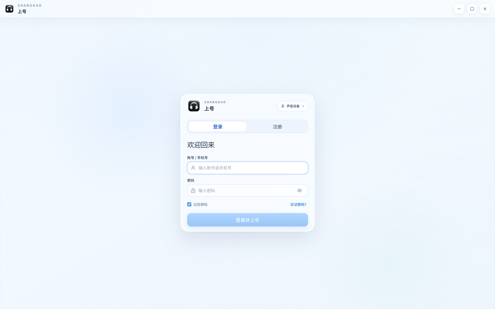
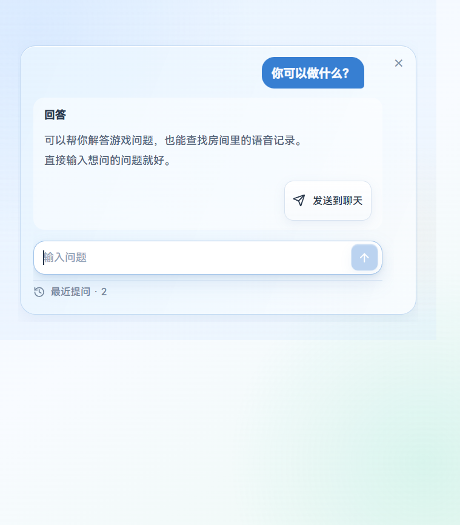

# 上号 v3.4.11（房间隔离与共享数据保护）

## 房间与隐私

- AI 提问历史按永久房间 ID 分开保存，包括回答与录音引用。切房间会重置助手面板、取消旧请求并拒绝迟到回答；服务器也不会把旧请求结果发到新会话。无法确定归属的旧全局历史保留在本机，不自动归入任何房间。
- 云端记忆继续核验账号、房主或当前房间成员权限；问答只使用自己的房间上下文，无房间归属的旧录音不再继承当前房间的记忆。
- 链接预览与自定义文本、转录 API 的公网校验绑定到实际连接，拒绝内网、保留地址、IPv6 绕过和不安全重定向。代理 fake-IP 使用独立解析后的真实公网地址，保持正常网页预览。

## 可靠性

- 共享转录严格核对记录版本，等长或更长的旧结果也不能覆盖新结果；增加已删除结果和检查点保护。建议正式版和开发版均更新，旧客户端无法获得新写入保护。
- 云端自动记忆先持久化任务再确认摘要上传，支持失败重试和服务器重启恢复；同房间串行处理，保留原房间身份、人工修改与关闭自动记忆的选择。只处理明确分享的摘要，不自动上传录音。
- 录音库扫描限制磁盘并发，共享库刷新以目录及索引变更判断，不再每次逐条检查所有记录文件。
- 助手错误反馈更清楚；云端纯文本转录明确标示估算时间位置，精确逐句时间轴可使用本地模型。

## 验证与边界

保留 SenseVoice 长录音分段、GLM 默认设置及原生电话快捷键。真实接口使用合成语音和普通算术问题验证，不上传私人录音；英雄联盟独占全屏、无边框与反作弊组合仍需现场验收。未做安装包瘦身。

具体结果见 [核对记录](https://github.com/soberbw-hash/shanghao/blob/main/docs/release-verification-v3.4.11.md)。截图采用本版隔离演示，不包含真实用户录音或私人聊天。

## 主要界面

