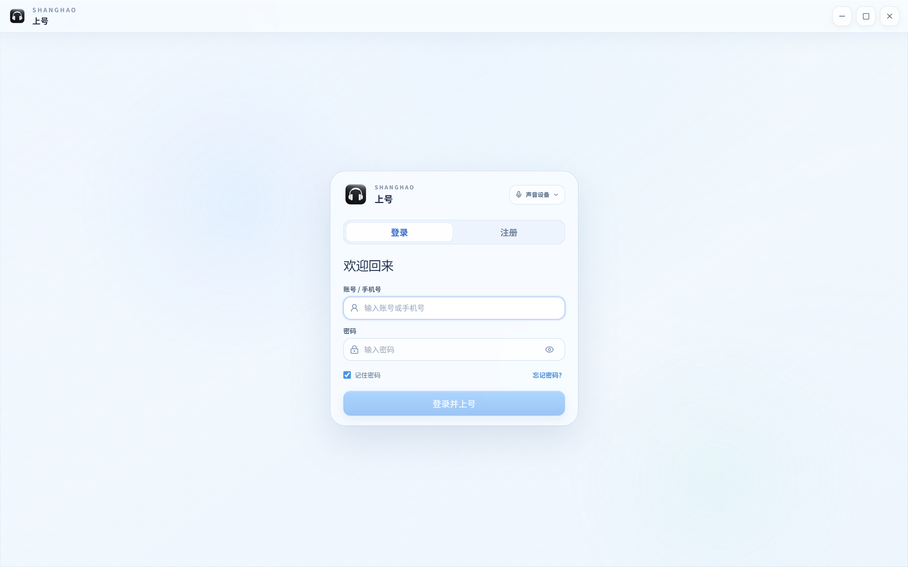
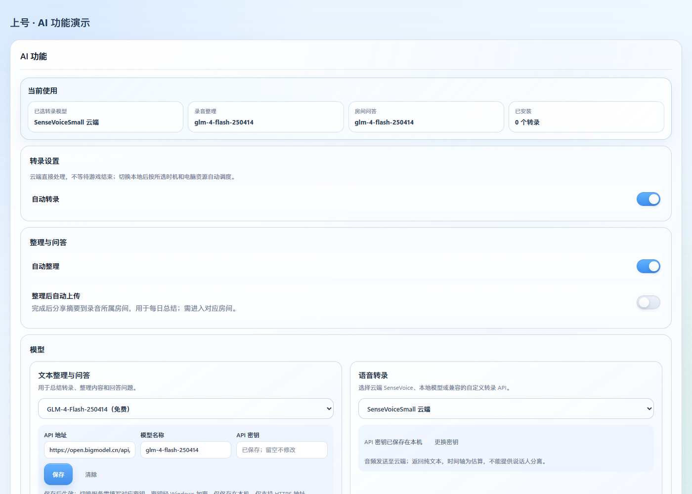
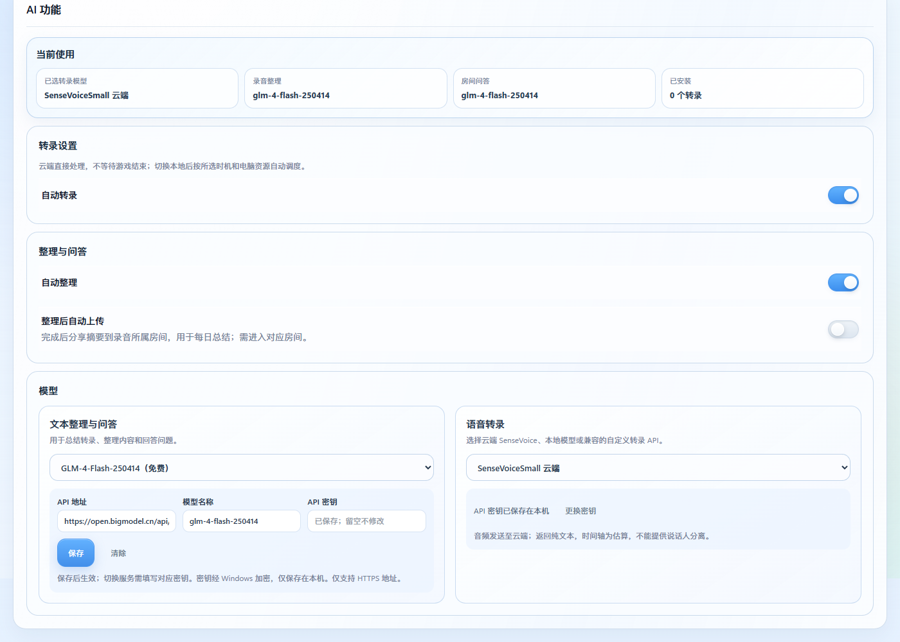
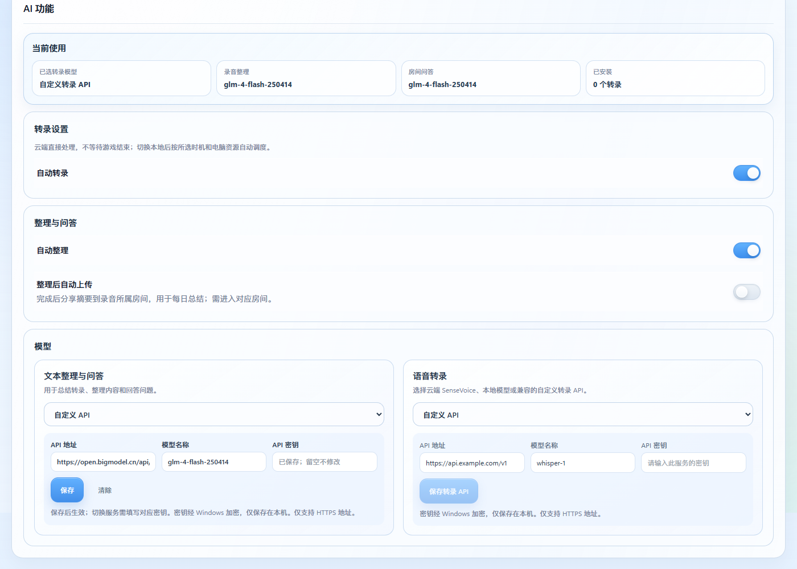
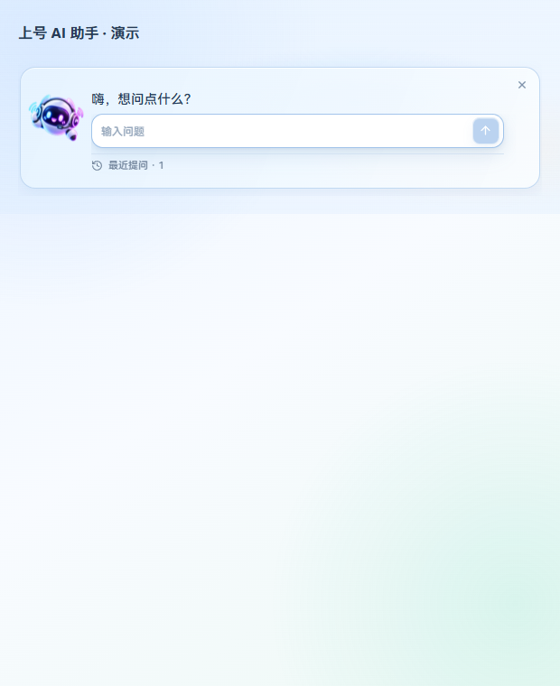
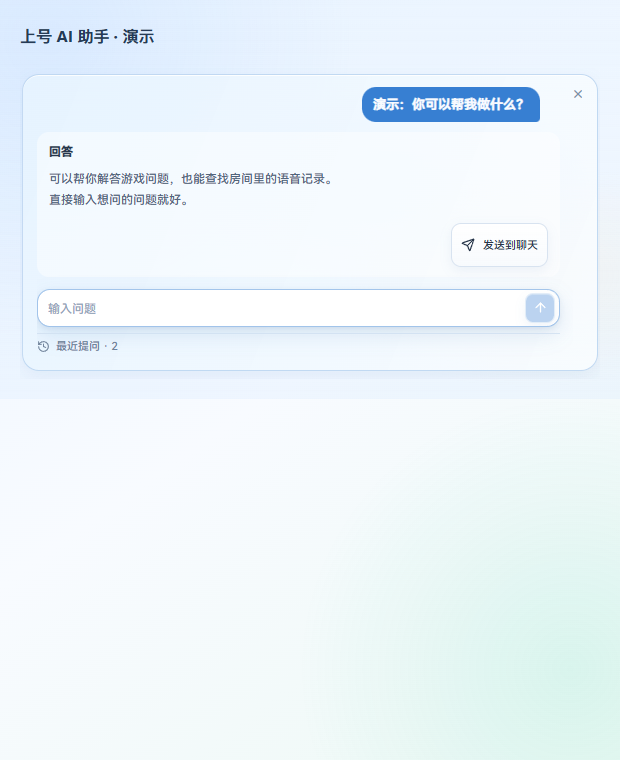
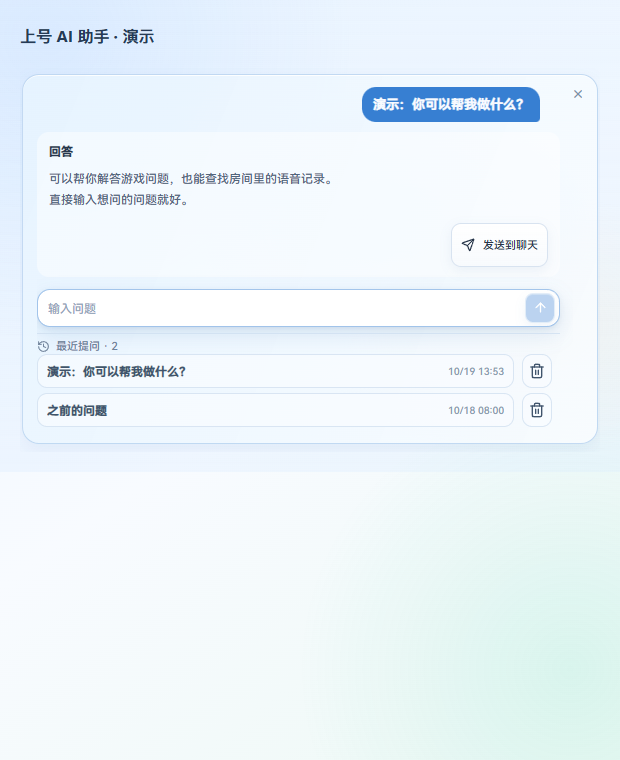
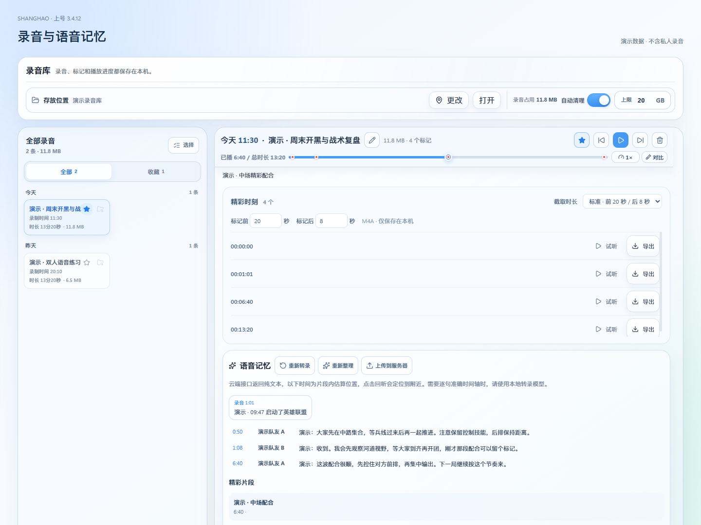
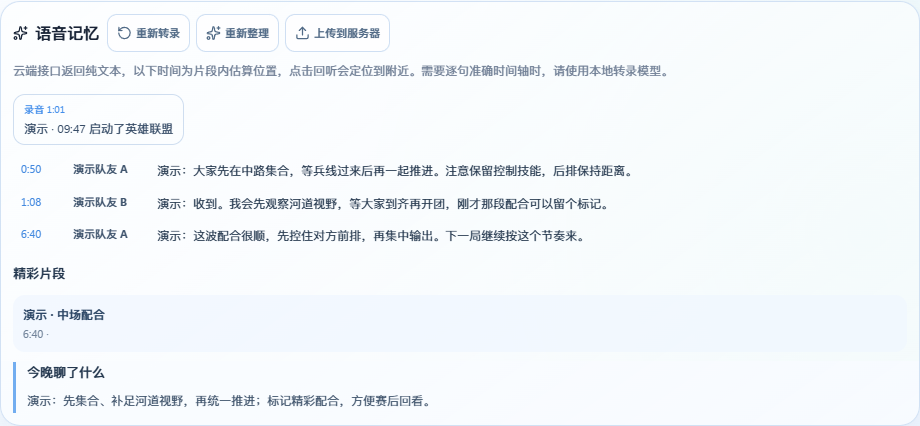

# 上号 v3.4.12：云端与本地 AI 协同、交互修复

本次集中修复录音转录、模型设置和日常交互。云端与本地各走自己的处理路径，切换模型时让选择、配置和实际使用保持一致。

## 转录与自动处理

- 本地模型对比不再误用全局云端选项；失败原因直接显示。云端临时服务故障对当前分段最多尝试三次，取消会及时停止；密钥、权限和余额错误不反复请求。
- 新设置默认开启自动转录、自动整理和自动清理，保留已保存的明确选择。云端直接处理，不等待游戏结束；本地保留后台资源调度。未配置转录密钥时等待配置，不产生虚假的识别失败，也不会自动下载大型本地模型。
- 超过单次时长或大小限制的云转录继续自动分段、合并，保留原始录音。纯文本云模型的位置仍为片段内估算；需要精确逐句时间轴时可选择本地模型。
- 自动上传摘要仍默认关闭，需单独选择；未上传的房间录音继续保留在本机，房间身份、历史和云端记忆保护继承 3.4.11。

## 模型配置与问答

- 两侧模型卡片同排等高，窄窗口自然上下排列；自定义表单一致。选择预设先编辑草稿，保存后才改变实际使用模型，避免“显示 DeepSeek、实际仍是 GLM”。
- DeepSeek 官方 `deepseek-flash` 已对应 2026 年 10 月 17 日的 V4.1-Flash-1017，无需填写虚构的新模型 ID。[官方接入说明](https://api-docs.deepseek.com/quick_start/)。需要自己的 DeepSeek 密钥，本次未把 GLM 密钥拿去请求其他服务。
- 文本、转录 API 更换域名或端口时要求该服务对应的密钥，同源编辑可保留旧密钥。凭据只保存在本机加密存储。
- 保留紧凑的助手提问、回答和历史布局，回答可以发送到聊天，历史按永久房间身份隔离。

## 录音与交互

- 标记文字移到播放器下面独立的一行，不再挡住录音标题；进度条红点与蓝色滑块的中心和有效轨道对齐，提示会自动收起。
- 只保留自动清理开关和容量上限；收藏、带标记及不能可靠判断的录音受保护，回收站恢复路径保留。
- 随机频道号只检查一次，动画从当前姿态继续；进房提示音改在 Worker 合成，保留原始采样、音量和输出路由，避免同步合成占用界面线程。
- 电话模式先门控上号麦克风，再播放短提示音，随后确认系统静音；快速松键不会迟到开启。系统通知失败有反馈与设置入口。天气移除精确定位和开发预览控件，默认尝试系统定位并使用实时天气，仍可手选城市。

## 界面演示

以下截图来自本次源码的实际组件，问答与录音内容均为隔离演示数据，不含私人录音或密钥。

## 验证范围

本轮已实际跑通隔离短语音的 SenseVoice 云转录，以及全局云端配置下的本地 Paraformer 对比推理。未提供 DeepSeek 密钥，未宣称已实际调用 DeepSeek。完整测试、构建、包校验及发布结果记录在对应发布核对中。

真实英雄联盟全屏、不同电脑与驱动下的整体进房听感仍需实机验收；移走音效合成阻塞不代表所有设备均绝对无卡顿。Windows 勿扰模式可能让通知进入通知中心而不显示横幅。正式版更新只下载，安装与重启仍由用户主动确认。
