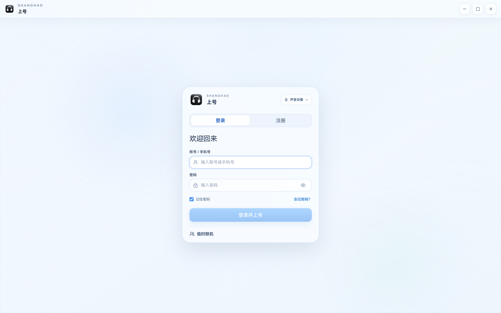
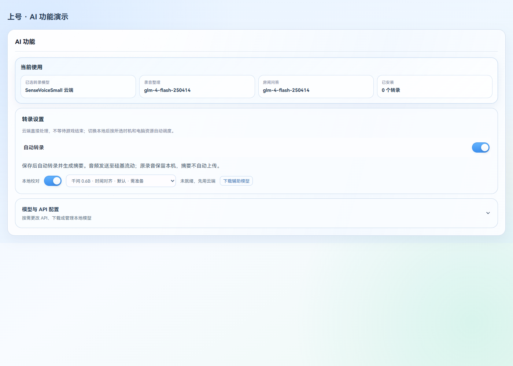
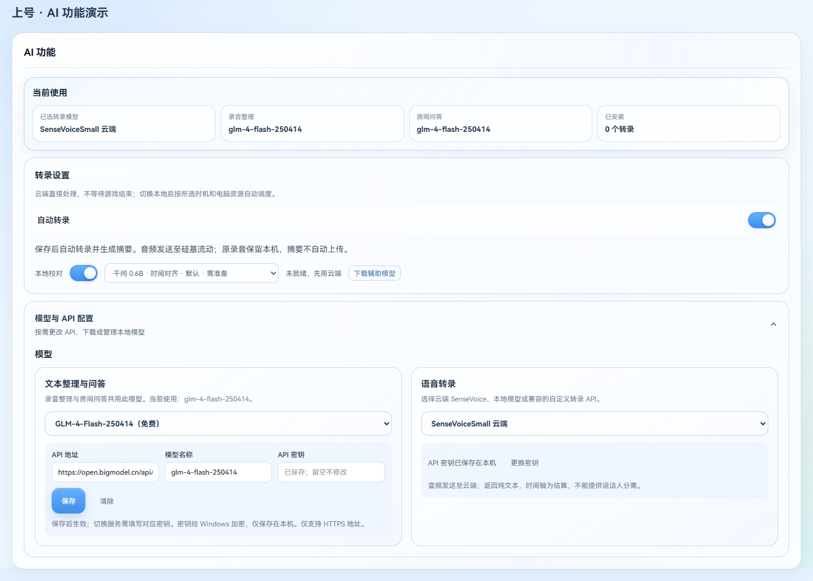
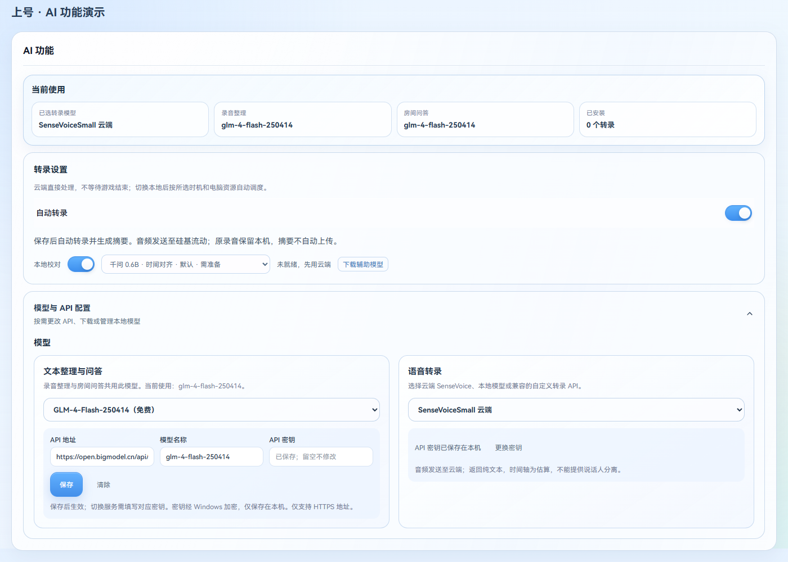
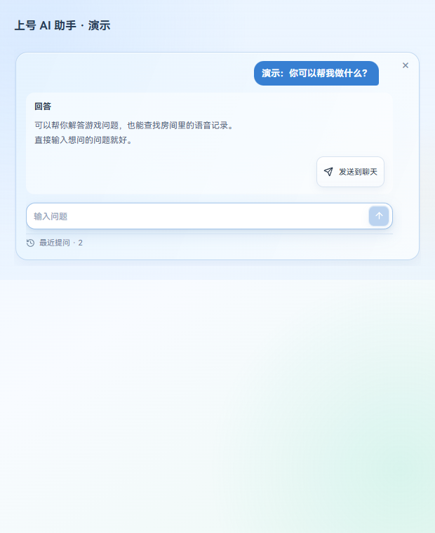

# 上号 v3.4.13：录音、语音稳定性与临时联机

本次集中完善长录音、融合校对和后台摘要，同时修复语音积压、电话模式按键与开发版启动入口。源码恢复 AGPL-3.0-or-later 开源，原仓库统一提供源码与下载。

## 录音读得清，也能接着处理

- 录音库把阅读放在首位：存储和模型设置折叠，操作按钮紧凑，列表卡片统一，文字稿缩小行距并保留来源标识。
- 默认自动转录；未转录的历史录音顺序排队，保留手动暂停。转录后自动在云端生成摘要，不因离开页面暂停，不自动上传到房间。
- 摘要提取实际事件、原话和有依据的趣事，避免空泛复述；长任务保留完成分段，瞬时故障有限重试，明确的账号或余额错误不反复请求。
- 云端按小段持久保存进度；有成员独立音轨时交替处理各成员，再按统一时间合并。修复只处理一个成员、切段续录空档和失败阻断其余成员的问题。
- 默认开启可关闭的云端＋本地辅助，辅助模型独立选择，默认 Qwen3-ASR-0.6B＋ForcedAligner；缺模型先保留云端结果并提示下载，不自动下载或换模型。
- 云端原稿、本地原稿分别保留，融合校对逐段生成，默认优先展示融合稿，完成前先显示云端。标出来源、变化和不确定处；结果一致时保留一致，不编造修改。
- 回听按实际点击的句／词定位。本地声学时间与云端估算位置明确区分；大模型校对文字不等于声学时间校准，旧混音不能凭空识别人名。
- 自动清理只回收完整检测确认静音的录音，保留有声短录音、收藏、标记及检测失败文件。

## 通话与游戏状态

- 中继发送按真实采样时长缓冲，丢弃过期积压；主线程繁忙和高采样率下不再直接截断整批音频，IPC 卡住可有界恢复。
- 连接质量使用当前音频路径的区间统计；连续坏链路只恢复受影响成员，增加迟滞和冷却，避免全房重连。
- 定位并停用服务器每十分钟触发更新、失败回退、连续重启的旧定时任务，保留服务器数据及其他系统任务。
- 电话模式开启和关闭都有提示音，补充后台原始输入、左右修饰键、侧键及前台权限诊断。管理员游戏可使用管理员开发入口；发布包默认普通权限运行。
- 英雄联盟支持读取房间人数、排队／选人／加载状态，以及排位、大乱斗等模式和实际对局分钟数。接口不可用时降级，不猜人数和计时，不发送英雄或客户端凭据。
- 手动静音时持续检测到讲话会轻提示，最多每分钟一次；排除按键说话及电话模式，不上传检测音频，不擅自解除静音。

## 日常体验

- 临时联机提供一排 SVG 头像及上传入口，创建房间自动分配号码；临时房间、局域网发现及远程协助按权限流程接入。
- “放歌”选择音乐应用并显示应用图标；与屏幕分享分开，不采集画面或默认分享全部系统声音。
- 优化 AI 设置、帮助页、角色阴影和麦克风柔和分段颜色；离开／吃饭／厕所／回来按钮固定位置。
- 开发版提供独立 CMD 启动入口，修复依赖缺失 VBS 的白图标问题，并保留管理员启动选项。
- 发布包直接上传 GitHub Release，减少大型中间 Actions 工件对免费存储额度的占用。

## 主要界面

以下来自本版实际组件和隔离演示数据，不包含私人聊天或真实录音。

## 验证与已知边界

自动化覆盖持久恢复、房间隔离、独立音轨、融合和实时媒体路径；真实录音及模型调用的证据范围见发布核对。纯云端时间仍为估算，识别文字不能保证逐字正确。

英雄联盟管理员／独占全屏按键、真实朋友长时间通话听感、跨网络多台设备及旧客户端点击升级仍需真实设备验证；隔离界面和自动化链路不代替这些结果。
