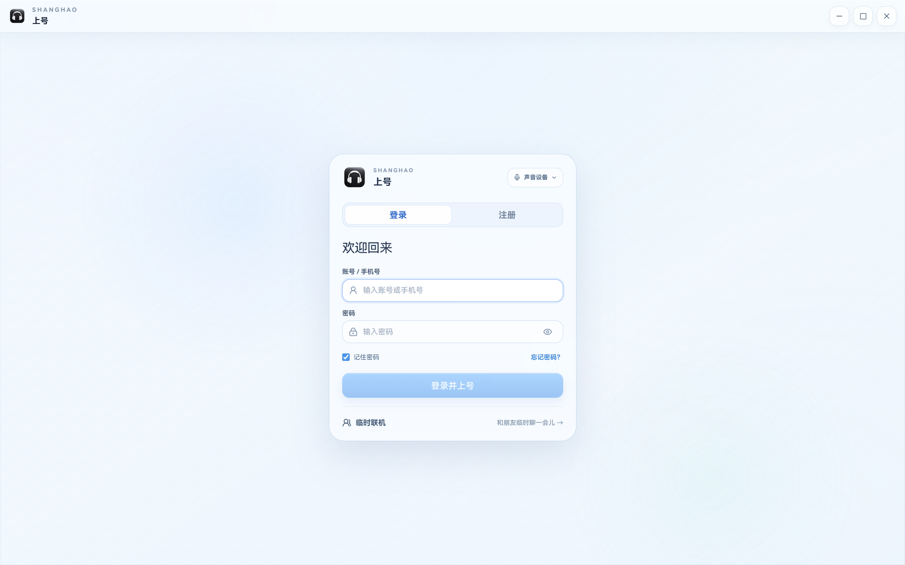
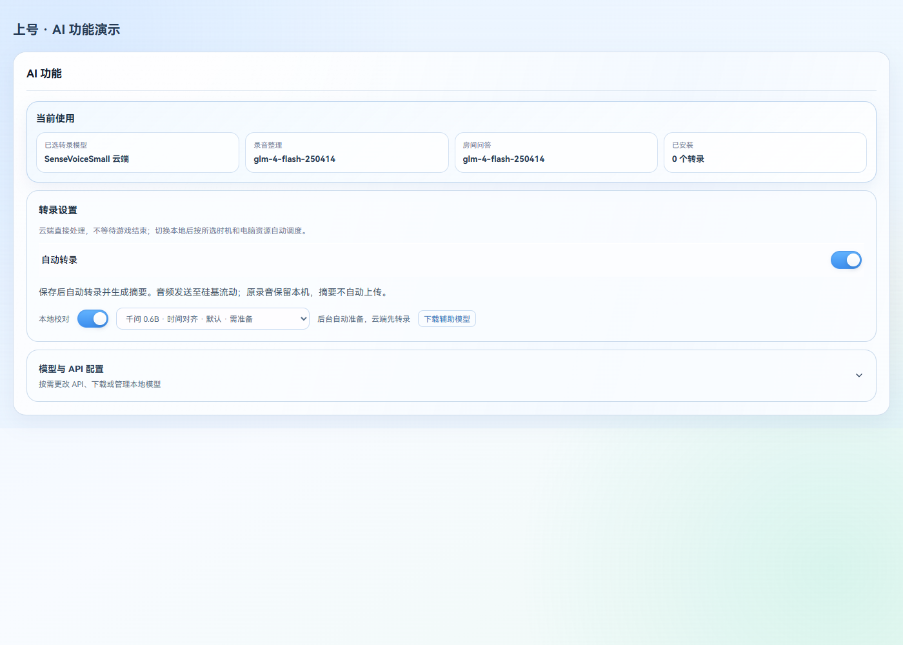
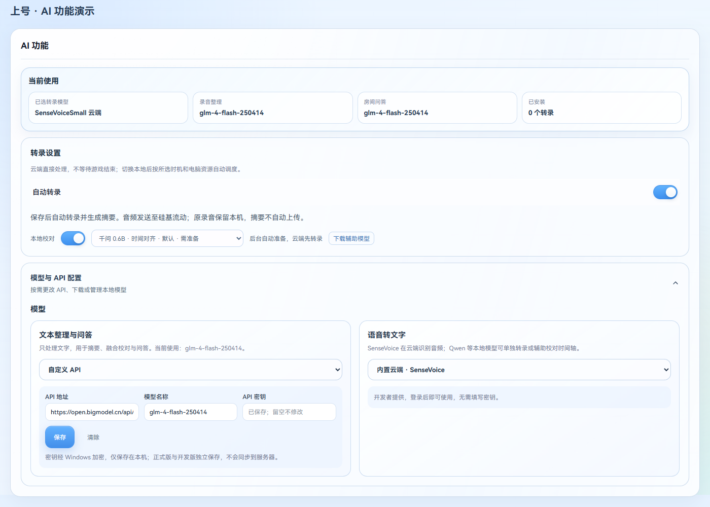
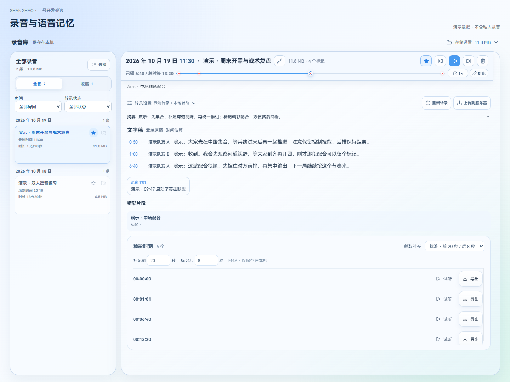
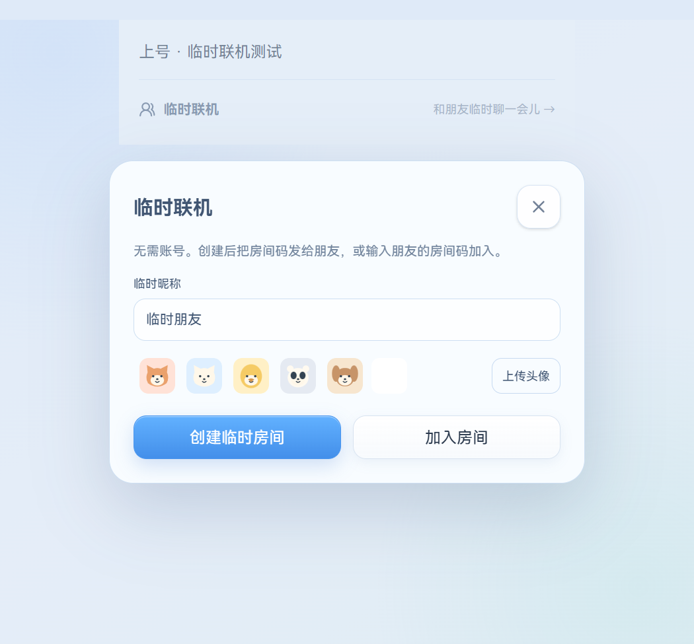
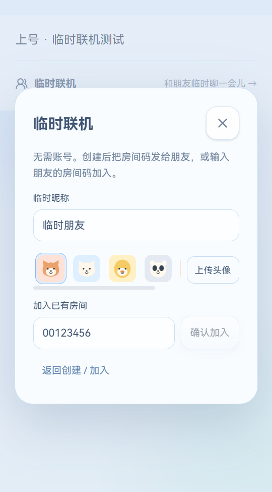

# 上号 v3.4.14（云端自动处理与临时联机优化）

## 录音交给后台

- 默认使用开发者服务器提供的 SenseVoice 转录和 GLM-4-Flash 摘要、问答，无需填写个人密钥；仍可切换自定义 API。
- 自动转录和自动摘要默认开启，历史未转录录音会排队。退出录音库不暂停，重启后恢复中断任务；网络和服务临时故障按间隔重试，保留已完成分段。手动暂停不会被自动恢复。
- 默认开启千问 0.6B 本地校对，后台准备识别模型及必要的时间轴组件。未就绪时先用云端，准备完成后补做校对；其他本地模型由用户按需安装。
- 0.6B 识别权重约 1.8GB，另有对齐和运行组件。下载让通话、游戏优先；硬件不支持本地推理时仍可使用云端。云端和本地原稿分别保留，优先显示融合稿。
- 摘要保存在本机，上传分享仍须手动操作；不会自动发布到房间。

## 临时联机更好找

临时联机改为独立弹窗，创建和加入各有入口；加入时才输入房间码。进房后顶部直接显示可复制的八位房间码，房间管理使用顶层窗口，修复白色弹层被场景挡住。无需账号，优先点对点连接；跨网络可能需要发现或中继服务，当前连接范围会明确提示。

## 电话模式与房间状态

- 修复电话键在 LOL 后台不响应、松键后延迟恢复的问题。开启、关闭均播放提示音。
- 聊天区“离开”和“吃饭”之间新增“电话”按钮，鼠标点击固定为切换；快捷键仍可选择按住或切换。通话期间座位文字和浮窗统一显示通话，结束后恢复原来的临时状态。
- 按本轮测试要求，Windows 程序默认申请管理员运行，启动时会出现系统授权提示。
- LOL 等待房间显示模式及人数，并使用等待画面；英雄联盟角标保留。迎宾门随真实成员进出开关，临时离开留在原座位。

## 验证边界

本轮实际账号的线上云端文字与语音接口、实际录音片段已经跑通。历史混音无法可靠还原成员姓名；只有独立成员音轨能直接绑定真实昵称。长录音完整处理、不同显卡与多台设备的实际体验仍依赖各自环境，不把片段验证说成全量录音验收。发布检查和资产哈希记录在版本核对文档中。

## 主要界面

以下为本版实际组件的隔离演示截图，不包含真实聊天或录音。

