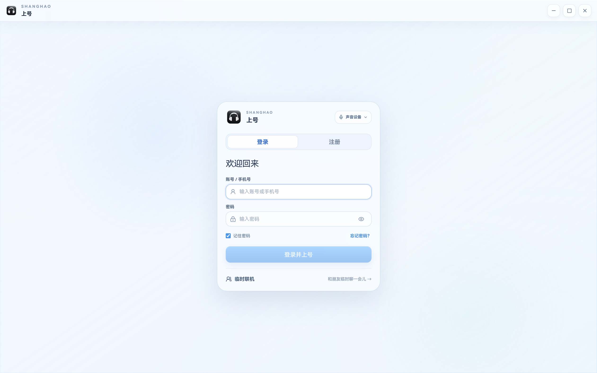
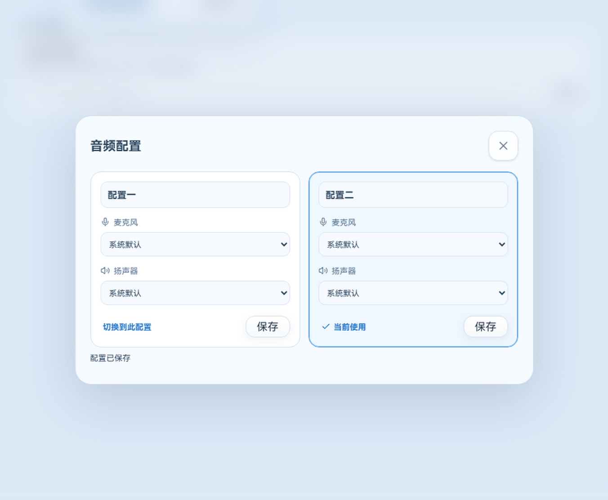
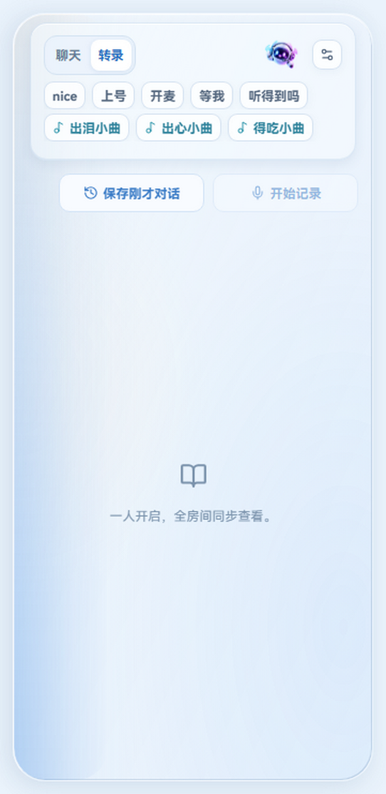

# 上号 v3.4.17

- 改进录音库：支持片段时间范围选择、回收站恢复，并优化文字稿和摘要显示。
- 优化房间状态切换、音频设备配置、屏幕分享以及不同窗口尺寸下的布局。
- 改进后台转录任务恢复和临时错误重试，保留已有的录音和文字。
- 新增实时纪事、语音回溯和云端管理的客户端与服务端实现，使用这些功能需要相应服务器能力。

## 主要界面

## 验证与已知限制

本地构建和代码检查通过；自动化冒烟测试 1674 项通过、5 项跳过。真实多人跨网络屏幕分享、长录音续转、游戏运行时性能和真实音频设备尚未完整验证。电话模式切换到离开时可能出现状态文字短暂闪烁。云端功能须部署并验证后才可使用。
