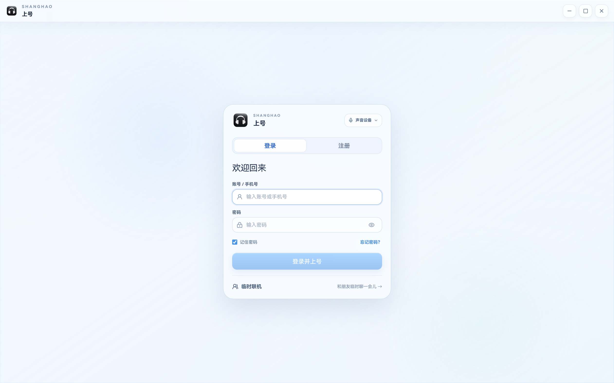
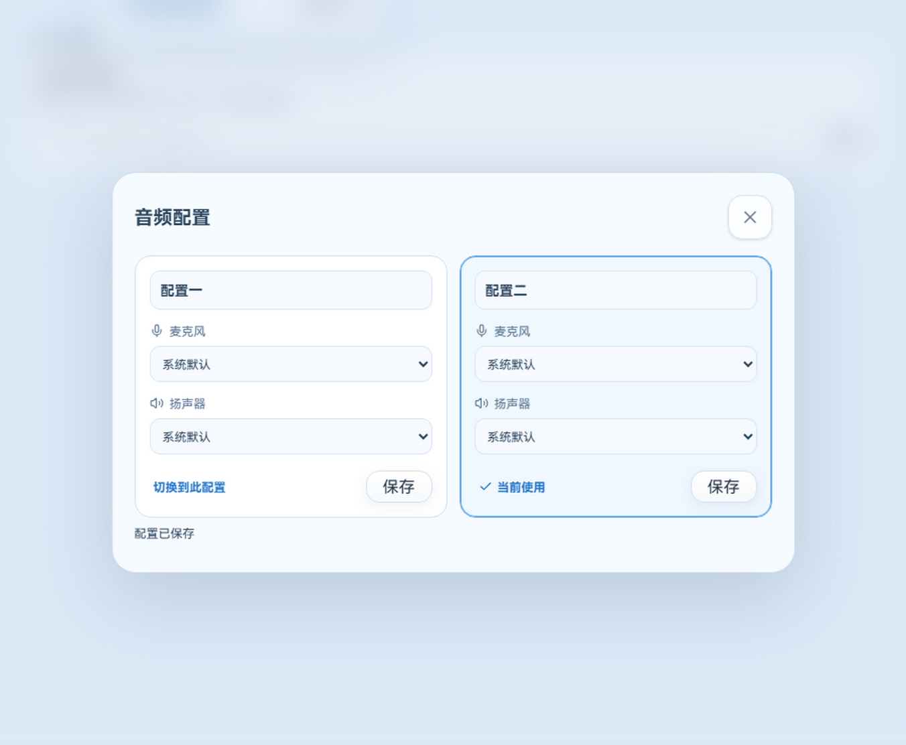
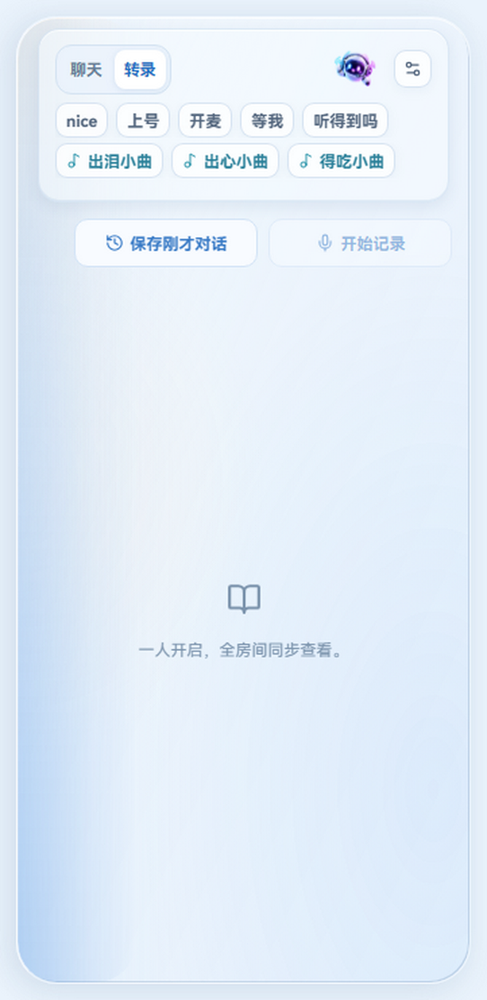

# 上号 v3.4.18

本版本已整合 v3.4.17 的更新内容与代表性截图，按功能主题统一整理；历史 Release 与 Tag 不再作为独立更新条目展示。

## 录音库与房间体验

- 录音库支持片段时间范围选择和回收站恢复，并改进文字稿、摘要及回放显示。
- 房间状态切换、音频设备配置、屏幕分享和不同窗口尺寸下的布局得到改进。
- 后台转录任务支持恢复与临时错误重试，尽量保留已经生成的录音和文字稿。
- 房间加入实时纪事与语音回溯入口；这些云端能力需要配套服务端支持。

## 语音 AI 与转录可靠性

- 加强 ASR Worker 的取消、排队、启动代际和模型切换处理，避免过期任务覆盖新状态。
- 转录时间轴无法对齐时保留原文并明确标记回退；融合校对保留云端、本地来源及需要复核的冲突内容。
- 增加录音游戏语境、分成员转录回溯、来源完整性检查，以及回溯文字稿的本地保存与回放联动。
- 模型质量对比支持导入、编辑和导出参考稿，避免在超出计算预算时产生误导分数。

## 设置与界面

- 新安装默认开启自动转录，同时保留用户明确保存的设置。
- 精简 AI 设置重复说明；普通界面文字不再被拖选，输入和可编辑区域仍可选择文字。
- 开发版二次启动时尝试恢复已隐藏的主窗口。

## 云端文字模型

- 云端文字模型支持 DeepSeek V4.1 Flash 默认路由和 GLM 自动备用；密钥只保存在服务端，客户端无需填写供应商密钥。

自动化验证不等于真实多人设备、真实游戏负载或长录音验收。已验证范围与未验证边界应分开看待；不会因安装候选版本删除本地录音、模型、转录或设置。
