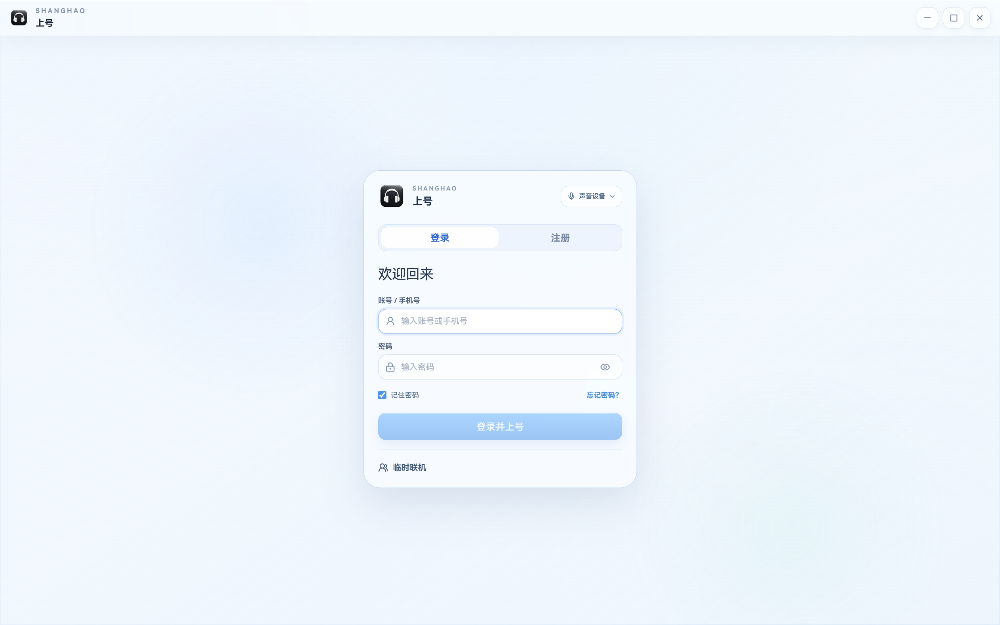
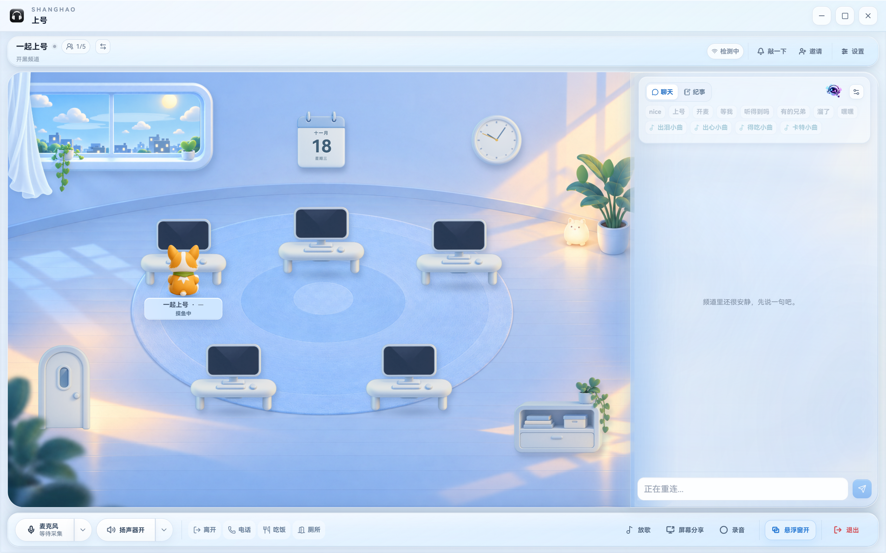
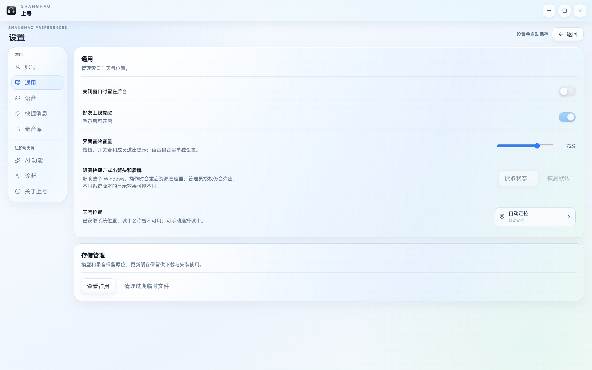

# 上号 v3.4.21 更新说明

- 调整房间名称编辑按钮的布局，头像增加鼠标悬停和键盘聚焦提示。
- 精简房间纪事的状态、时间和排版，移除评价按钮；生成纪事时参考房间记忆中可确认的称呼。
- 改进成员状态浮窗、角色离场动画恢复和参与者自动加入纪事的处理。
- 修复开发过程中热更新可能导致房间连接引用丢失的问题，并区分屏幕分享的连接和采集错误。

本次改动仍需真实多人设备验证，包括屏幕分享、各成员的转录和角色动画。英雄联盟组队状态不一致尚待在游戏运行时排查；长录音和旧版本升级也未完成实机验收。线上功能取决于服务端实际部署及配置。

## 主要界面

