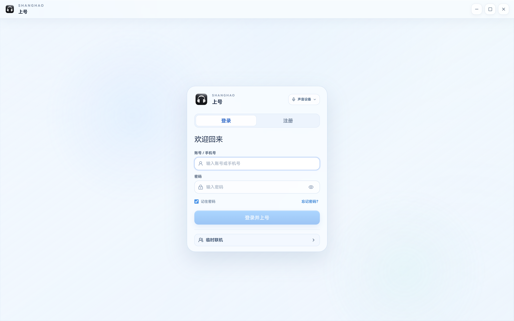
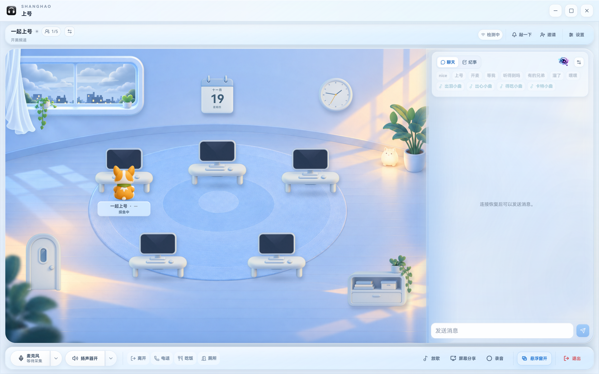
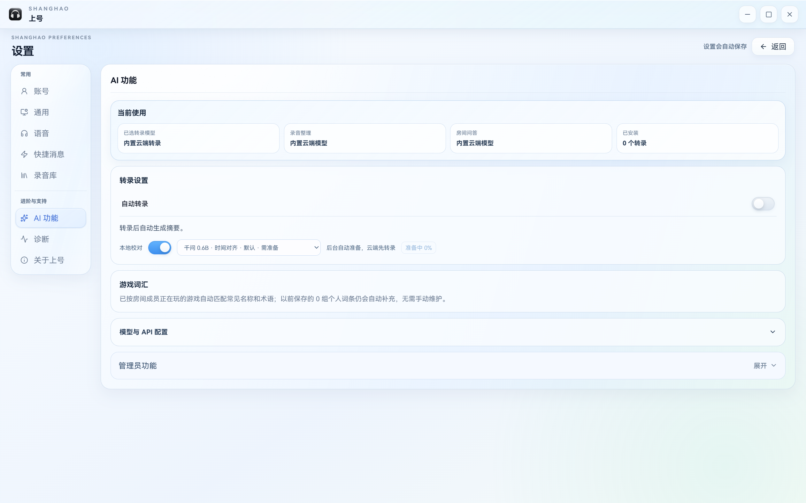

# 上号 v3.4.22 更新说明

- **屏幕分享** Windows 选源时先展示可选窗口和显示器，再加载缩略图。启动采集会等预览释放资源，并重新确认选中的窗口或显示器。Electron 升级至 45.3.4。
- **房间纪事** 一人开启转录，成员自动参与，每条麦克风音轨按发言者处理。可以随时停止提供自己的语音。房间问答与纪事使用记忆中的明确称呼。
- **录音与设置** 新设置默认开启录音库自动转录。已手动关闭的设置继续生效。移除了转录稿下方的词汇说明，统一了账号、通用、语音和 AI 页面的内容宽度。
- **更新和链接** 更新卡片可拖动，下载期间可以继续聊天。单链接消息把文字和站点图标放到一张卡片里。
- **快捷音乐** 新增 8 段 AI 漫剧音乐。可在快捷消息选择，在上号素材按音频包试听。

隔离测试采集到了 720p、1080p 和 1440p 的真实桌面画面。正式版在实际多人房间的分享接收、旧版自动升级和游戏内听感仍需实机验收。

## 主要界面

