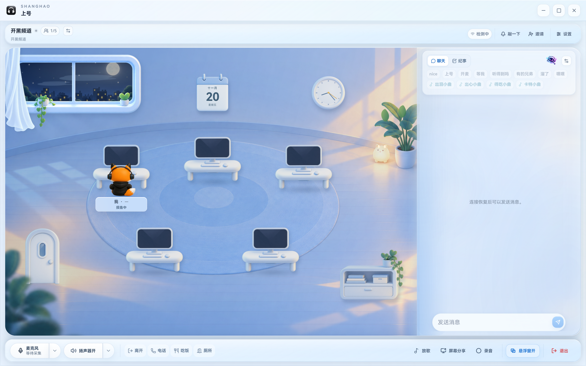
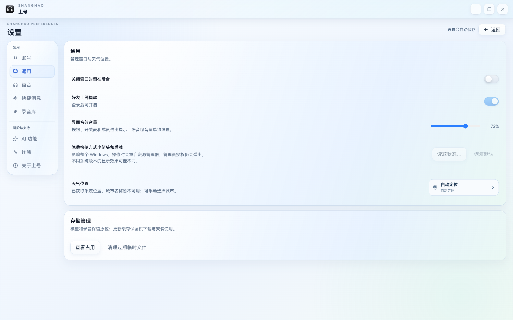

# 上号 v3.4.23 更新说明

- **屏幕分享** 修复正式版选择显示器后无法启动采集的问题。Windows 客户端默认按普通用户权限启动，发布检查直接运行正式包中的程序并读取实际画面。
- **聊天与设置** 统一链接卡片尺寸，增加 GitHub 站点图标，柔化聊天列表底部的模糊过渡，改善首次打开 AI 设置时的布局稳定性。精简录音复核说明和关于页的外部入口。
- **房间纪事** 同一房间的成员都可以查看当日内容。纪事在北京时间零点换日。房间当前游戏和记忆中的明确称呼会作为转录语境。
- **昨日回顾** 优先展示有具体内容的对话、游戏及约定，移除称号。

房间纪事的跨成员同步、零点换日和服务器生成的回顾需搭配新版房间服务。真实多人房间的远端分享接收仍需实机确认。

## 主要界面

