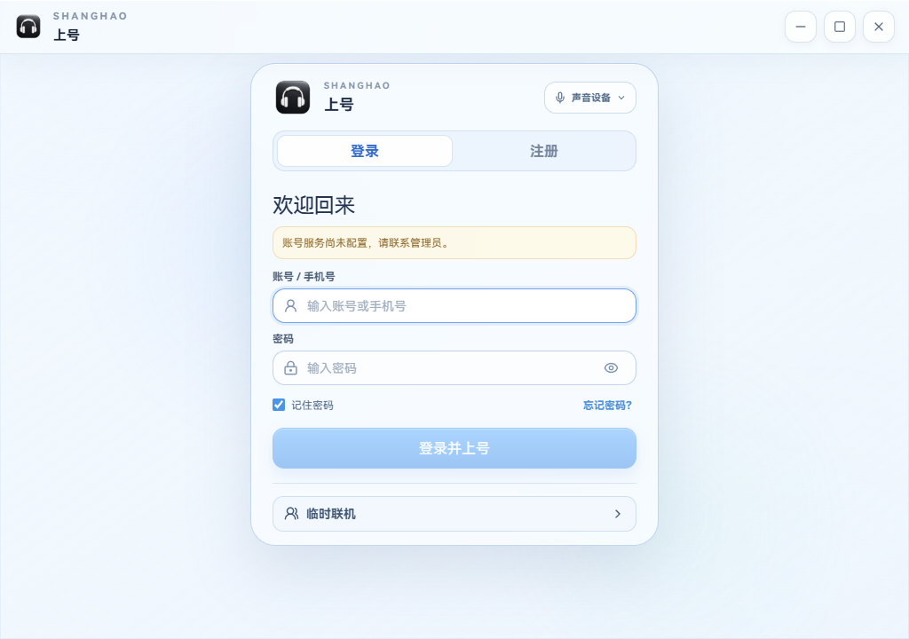
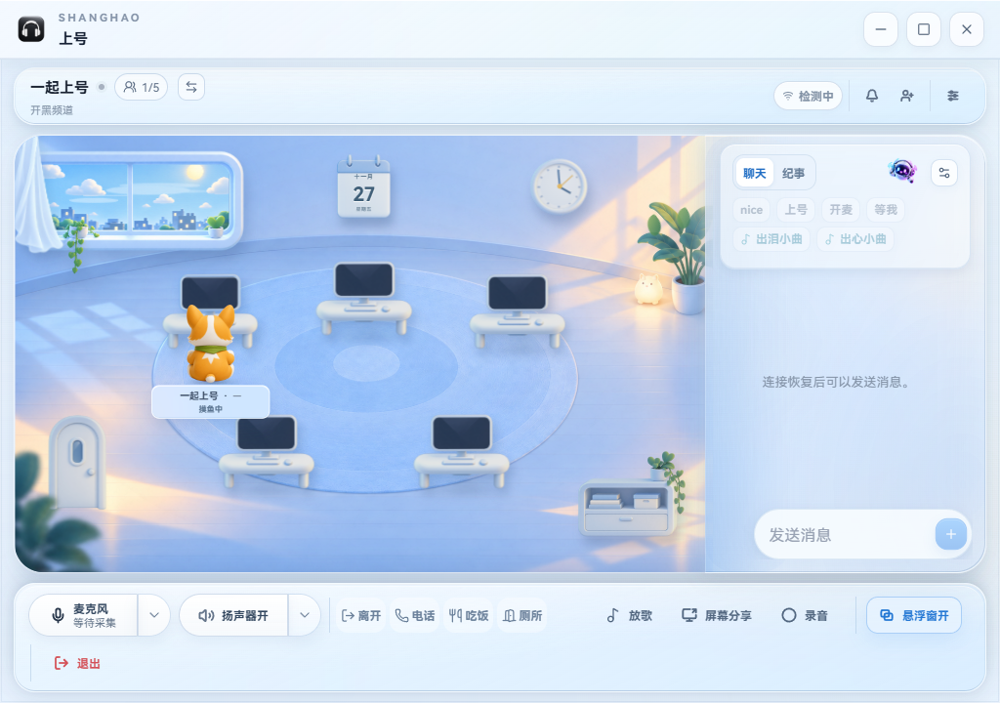
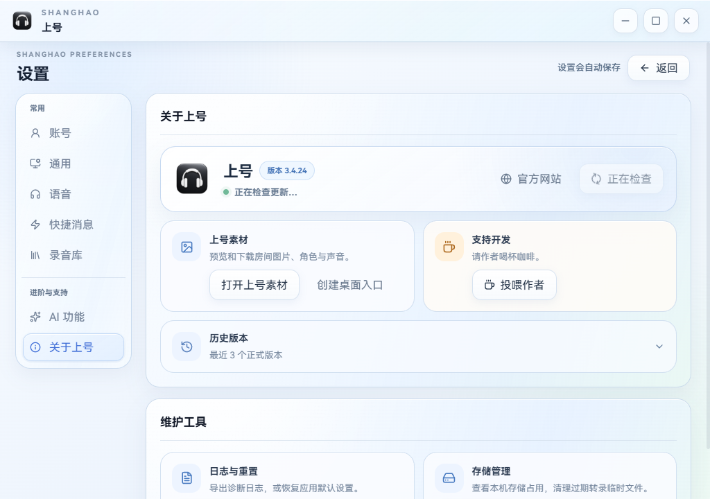
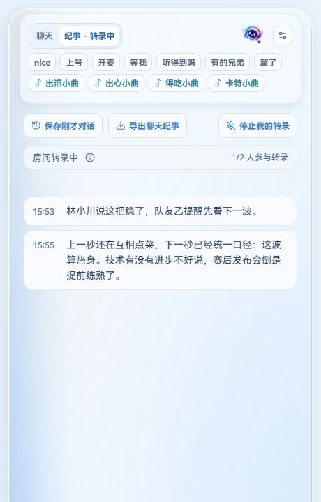

# 上号 v3.4.24 更新说明

- **房间与麦克风** 确认入房后才接收房间语音并申请麦克风，退出时立即关闭。手动开麦会同步结束离开、电话、吃饭和厕所状态。
- **聊天与纪事** 聊天框可选择或拖入图片，长列表上下边缘自然渐隐。收到新内容时跟到最新项，消息送达确认会保留当前阅读位置。聊天和纪事快速切换时保留草稿。
- **Windows 桌面通知** 好友敲一敲时可直接选择「进入房间」。聊天通知可显示图片缩略图、定位消息，也可在默认浏览器打开链接。保存语音回溯和转录完成后可跳到对应录音。
- **录音和 AI** 录音库存放在本机。自动录音、自动转录可单独设置，默认在游戏结束后处理待转录录音。AI 设置提供云端、云端加本地和自定义语音 API。
- **房间纪事与昨日回顾** 纪事尽量保留有具体内容的话题，根据当前游戏匹配术语。昨日回顾按全天可用记录概括有代表性的对话与活动，记录不足时标出实际覆盖范围。这些改进依赖兼容的房间服务。
- **设置与交互** 官网入口回到「关于上号」。诊断导出、安全重置、查看占用和过期缓存清理集中在这一页。调整了进出房间、放歌和设置切换时的反馈。

自动化覆盖房间语音准入、进出房间、聊天与纪事连点、通知动作、屏幕分享与五人媒体路径。真实多人网络、Windows 通知的系统横幅、游戏高负载帧率和现有客户端的点击升级仍待实机验收。

## 主要界面

