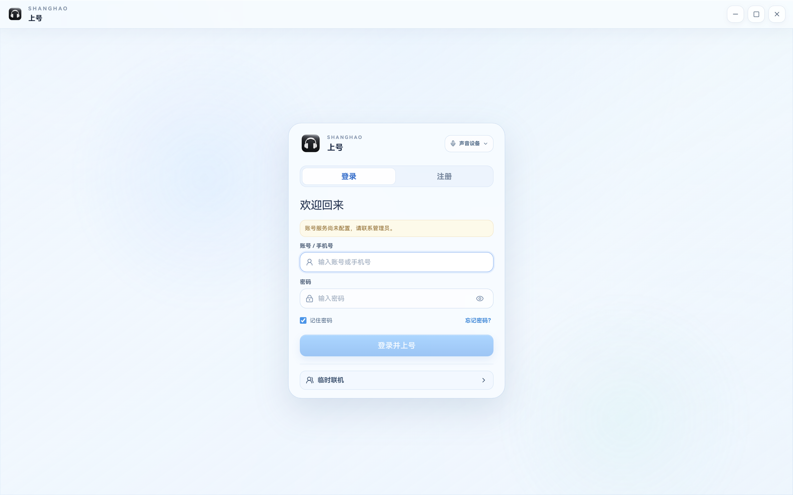
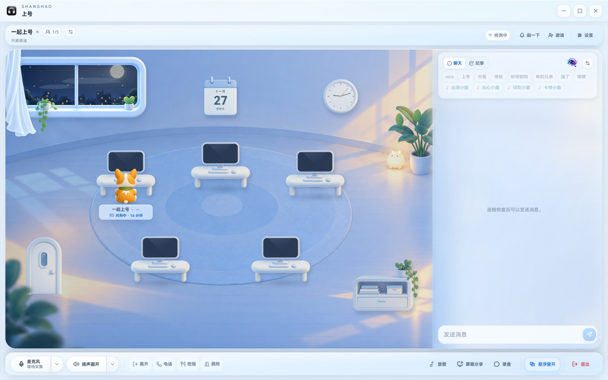
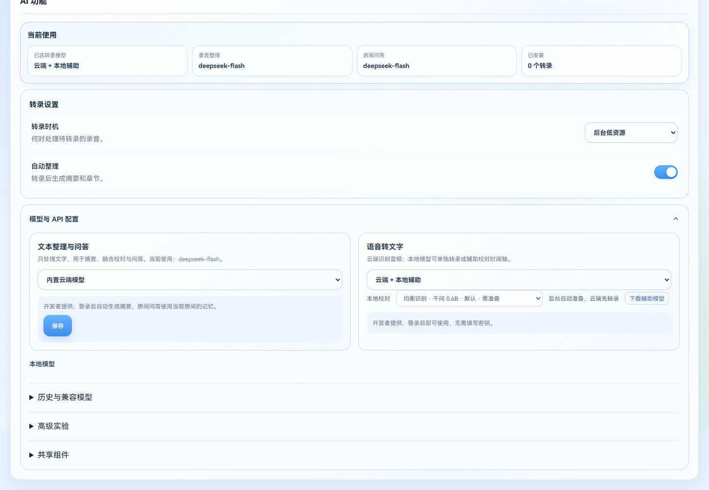

# 上号 v3.4.25 更新说明

## 房间交互

- 聊天和纪事在滚动时逐渐淡出上下沿，最新一条可以完整阅读。聊天输入框聚焦时保持对齐，图片可直接粘贴或拖入。
- 放歌和屏幕分享打开时淡入柔和的背景模糊。屏幕分享先打开选择窗口，再扫描可分享的屏幕与应用。
- 关闭音频配置后可以继续使用麦克风菜单。切换电话状态时，移除了麦克风与扬声器按钮的额外闪烁。

## 设置与转录

- 设置左侧菜单保持固定。展开「模型与 API 配置」会平滑滚动至配置区域。管理员功能移至「关于上号」的维护工具。
- 「语音转文字」提供云端、云端加本地辅助、自定义语音 API。新配置和重置默认采用云端加均衡识别，已有选择可以继续使用。

## 主要界面

以下画面使用隔离环境中的演示数据。

## 兼容与验证

支持 Windows 10 / 11 x64，沿用协议 7。已在隔离环境验证设置、聊天和纪事的交互。游戏同时运行时的鼠标响应仍需实机验证。
