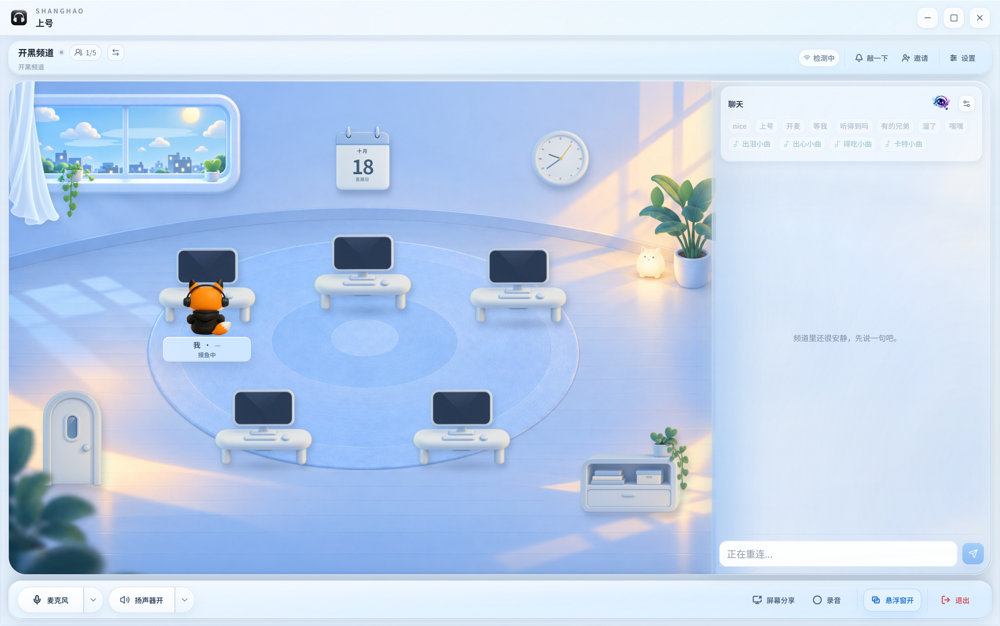
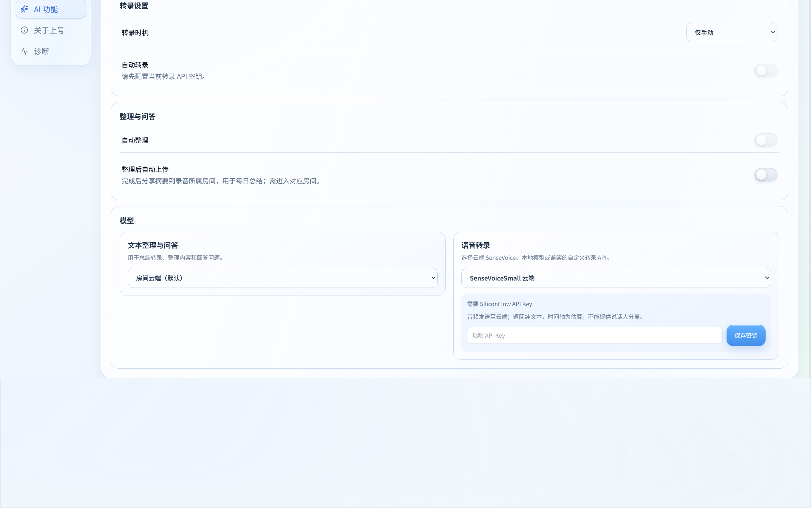
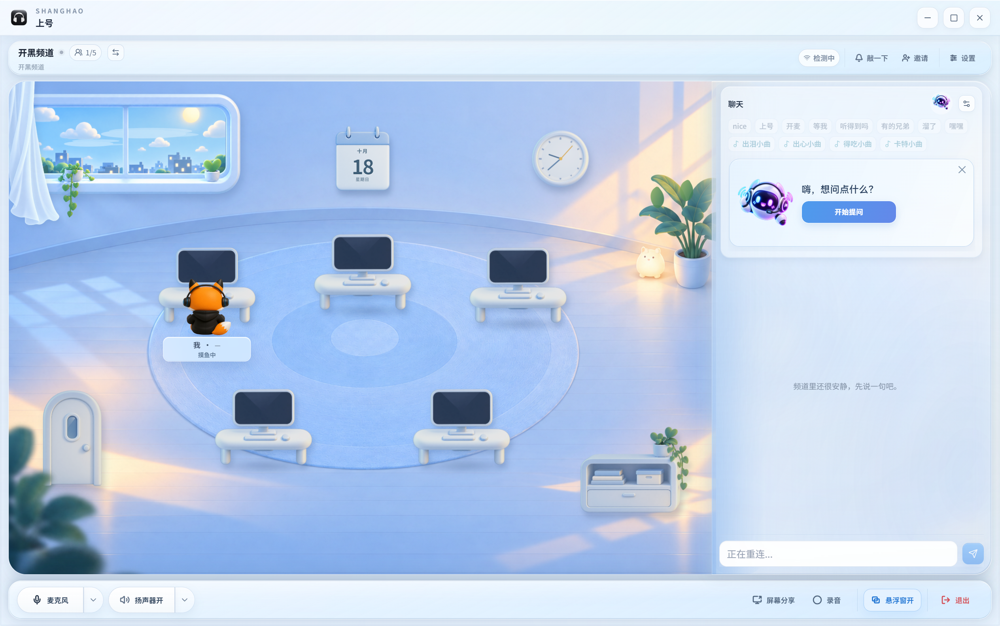

# 上号 v3.4.9（电话快捷键与 AI 助手）

## 这次更新

- **电话模式更可靠。** 除原有全局按键监听外，Windows 增加独立的只读按键状态检测。游戏中按着 Shift、Ctrl 时仍能触发所选方向键；两条路径共享按下状态并按采样时间去重，辅助进程退出时回退原监听。屏幕锁定不能被当成松开按键而自动解除静音。
- **AI 小助手进入聊天区。** 使用原始四张形象，在原有快捷消息区域展开，原地从“开始提问”变成输入框。保留轻微呼吸，鼠标靠近时柔和跟随，点击可以打招呼；请求处理、异常和游戏消息仍由实际业务状态驱动。关闭时不再闪回开始按钮，支持减少动态效果。
- **模型选择更清楚。** 左侧选择文本整理与问答，右侧选择语音转录；只在本地转录模式显示下载库。支持 GLM、DeepSeek、自定义文本接口，以及 SenseVoiceSmall 或自定义转录 API，密钥只在本机加密保存。
- **结果不用转两遍。** 正式版与开发版共用录音及转录库；旧目录独有结果安全合并，完整结果优先于空失败记录，导入前备份。返回录音库时刷新共享结果。
- **开发版入口修复。** 修复开发服务退出导致桌面入口打不开的问题，统一开发版快捷方式、应用标识及官方图标，并修复冲突的 Electron 入口。
- **素材与体验。** 四张吉祥物和参考图归档进素材库；快捷消息留白更宽松，修复设置标签首次跳错等问题。

## 使用与边界

云端转录需要自行配置 SiliconFlow 密钥，会上传所选音频。SenseVoice 返回纯文本，时间轴为估算，不提供真实说话人分离；本地模型继续可用。价格与可用额度以服务商账户为准。本机真实测试中 GLM 请求成功，SenseVoice 被账户余额限制拒绝，不能把接口接入当成已成功转录。安装包不包含个人密钥或用户录音。

自动化覆盖按键事件去重、丢松键恢复、Shift/Ctrl 组合、请求错误及共享存储等路径；仍未完成《英雄联盟》独占全屏、无边框及所有反作弊/驱动组合的实机验收。此版本不更改房间信令协议，不需要重启 Relay。

## 主要界面

截图来自本版隔离的视觉演示状态，不含真实账号、聊天或录音；房间演示未建立实际通话。

## 验证

发布检查包含 TypeScript、Lint、测试、Windows 构建、运行资源、五人音频/媒体与隔离动画回归。确切结果和公开资产核验写入本版发布核对记录，未通过的检查不会写成成功。
